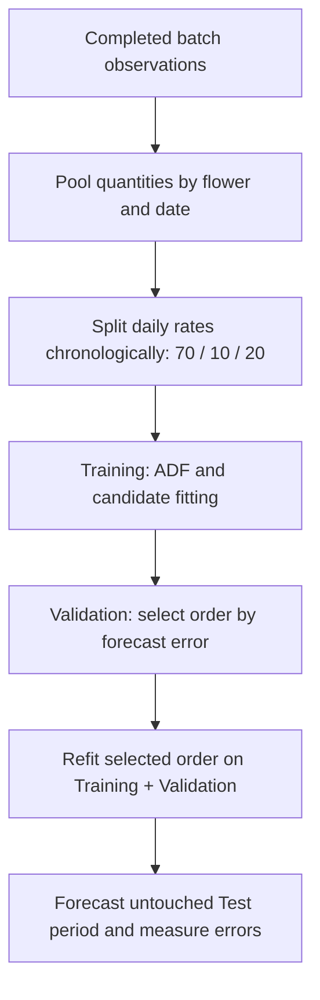
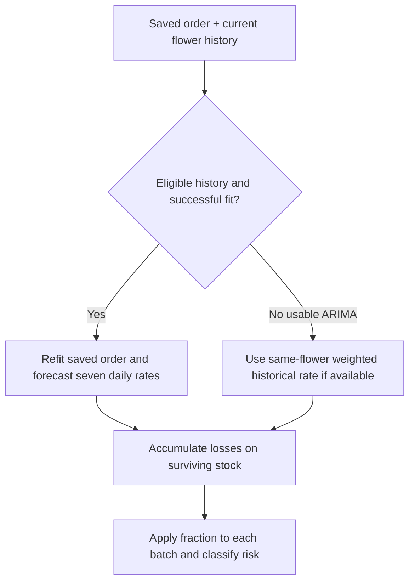

# Business Logic

## Live daily observations and user-activity catch-up - approved checkpoint, 2026-11-17

Steps 2 and 3 use live daily drafts and user-activity catch-up. Stock-In inserts one draft per batch and Philippine date; spoilage, actual pickup/delivery completion and other inventory movements rebuild that same day's values from the ledger inside the inventory transaction. Successful eligible Admin/Supplier login and logout verify missing completed days, including zero-movement days. Today stays a draft. There is no periodic/date-based scheduler; without eligible login/logout, catch-up waits.

Late changes invalidate derived history and rewind the checkpoint; a revision prevents advancing past a concurrent invalidation. Login/logout share the lock, process at most seven pending dates per event by default, and leave failures pending without blocking authentication. Failed, inactive, temporary-password, Client and Delivery accounts do not trigger catch-up. Existing business and prediction-eligibility rules are preserved. The prior Windows task is disabled and its installer/runner scripts are removed. See [Daily Observations](DAILY_OBSERVATIONS.md) for setup and review.

**Approved checkpoint:** [`bb8d9bb`](https://github.com/wyntheprogrammer/flowertrack-ims/commit/bb8d9bbbc989e8069587e78fefc364286c4fe468) is published on application main after Wyn's review/approval. Agent-run full regression: **137 passed / 1,760 assertions**; activity observation suite: **28 passed / 239 assertions**. No periodic observation scheduler remains; the prior local Windows task is disabled. This section supersedes older collector-only and timer-based descriptions below.

**Last updated:** 2026-11-17

## Storage-condition capture approved — 2026-11-17

- Wyn reviewed the storage workflow, requested dropdowns, and approved committing/pushing the application and updating this documentation.
- Stock-In requires actual storage condition. Stock-In and Batch Edit use Ambient/Chilled dropdowns; existing saved custom values are retained as an option when editing. Batch Edit permits Unknown (null). Backend validation remains required string, maximum 30 characters for new receipts; optional/nullable string, maximum 30 characters for metadata edits. The dropdown change does not add an enum restriction to the API.
- Inventory and Batch detail responses/display include storage. Receipt corrections display storage without editing it; changes to existing storage go through Batch Management.
- Storage is saved on the existing inventory_batches column and included in receipt/metadata snapshots, batch version checks and audit safe fields. Edits append zero-quantity metadata history and do not alter stock, reservations or historical daily observations. No migration or inferred legacy storage was added.
- Required repository setup installed Laravel Boost v2.10.4 and generated AGENTS.md/CLAUDE.md guidelines plus boost.json; dependency lock changes are included.
- Agent-run verification: full suite **109 passed / 1,467 assertions**; dedicated Batch suite **9 passed / 146 assertions**; Pint, Composer validation, production build and diff whitespace checks passed. Build retains the known image-reference and large-chunk warnings. Wyn's acceptance is for this storage UI/workflow, not a new claim of completed forecasting browser acceptance or real-world accuracy.
- Application checkpoint: [`3db137b`](https://github.com/wyntheprogrammer/flowertrack-ims/commit/3db137b3a12194d9ba8a56c7f76c5426492f39e9) (published and verified on main).
- **Next:** trustworthy completed-day observation collection and reconciliation, then reviewed day closing/catch-up. Dashboard current-risk alerts, final automatic-refresh browser acceptance, Client storefront and real-data/deployment validation remain separate work.

**Status:** Partially confirmed. Only rules explicitly approved by the project owner are listed as confirmed below. All other rules remain undecided.

## Flower-level ARIMA forecasting

Batch daily observations remain the inventory record. Laravel reads completed, unexcluded rows before the Philippine forecast date with positive opening stock and spoiled quantity between zero and opening stock. It groups by flower_id and calendar observation_date, summing opening_quantity and spoiled_quantity. This query leaves every batch record intact. The Flower-level daily spoilage rate is SUM(spoiled_quantity) / SUM(opening_quantity). For example, losses of 2 from 10 and 3 from 90 on the same day give a flower rate of 5/100. Verified zero-spoilage days count; a missing calendar date remains missing.

### Training and evaluation

Run `php artisan spoilage:train` for all flowers or supply one flower ID. For N continuous days the Training set ends at floor(0.70N) and Validation ends at floor(0.80N). Test contains the remaining days. FlowerTrack requires 30 Training observations and nonempty Validation and Test sets. At 43 days the split is 30/4/9; at 42 days Training has only 29. This is a project safeguard. Training also rejects gaps and constant Training history.

The ADF test uses Training alone. An original-series p-value below 0.05 selects d=0. Otherwise the code checks first differences when they vary and uses d=1 even if stationarity is inconclusive. Here d counts differencing operations. With d fixed, p and q each range from 0 through 4, excluding the pair (0,0). For up to 24 candidates, fit on Training, forecast the full Validation period and clip finite predicted rates to [0,1]. Skip failed or invalid candidates. Record Validation MAE, MSE and RMSE plus fitted AIC and BIC. Rank by lowest Validation RMSE, then MAE, AIC and BIC.

Fit a new final model of the selected order on Training + Validation and forecast exactly as many days as are in Test. Clip rates to [0,1] and compare with actual daily Test rates. For error e = predicted rate − actual rate:

| Test metric | Calculation | Interpretation |
|---|---|---|
| MAE | mean(abs(e)) | Typical absolute miss on the rate scale |
| MSE | mean(e²) | Squared error, giving larger misses greater weight |
| RMSE | sqrt(MSE) | Error on the rate scale, sensitive to larger misses |

Lower is better. MAE of 0.03 means a mean absolute miss of three percentage points. These measures quantify daily rate errors; they do not establish a percentage of batches classified correctly. Test outcomes play no role in selecting the order.

### Live production forecast

Laravel saves the selected order, ADF result, split sizes, validation and test metrics, version, training date and history range/hash in the nullable JSON flowers.spoilage_model column. Production reuses order metadata and refits coefficients on available history, including days previously held out for evaluation. It skips the candidate search. A version-matching order with history ending before the forecast date, at least 43 continuous dates through yesterday, and a successful finite forecast yield **Flower ARIMA**. Changed batches sharing a flower can reuse its forecast in the bulk Python call.

If the order is unavailable, history is short or gapped, or a supported fit/forecast failure occurs, **Flower historical fallback** repeats that flower’s total spoiled / total opening over the horizon. Empty history yields **InsufficientData**, with no risk label. Missing days are never filled with zero.

ARIMA produces daily rates. Inventory logic converts them to a seven-day fraction from today through day six: begin with F=0; for each clipped daily rate r, update F = F + (1−F) × r. For example, two successive 10% daily losses yield 19% cumulative loss. Laravel multiplies the final fraction by each eligible batch’s current remaining quantity, in its own unit. Two batches of the same flower can therefore have the same fraction but different predicted quantities.

| Low | Medium | High | Critical |
|---|---|---|---|
| F < 10% | 10% ≤ F < 25% | 25% ≤ F < 50% | F ≥ 50% |

Predictions are advisory. Actual inventory spoilage is recorded separately. [Verified application source](https://github.com/wyntheprogrammer/flowertrack-ims/tree/b32634471a9dbbadf829ca7d013f11b25fb61b40/scripts/spoilage).

## Stems and supplier-made bouquets — confirmed 2026-11-04

This current scope supersedes earlier stem-only catalog/order assumptions.

- The shop sells both loose flower stems and pre-made bouquets received already assembled from the supplier.
- Treat stems and finished bouquets as distinct stock items with their own product code, information, minimum-stock threshold, selling price and receiving batch records.
- Base stock/sales units: Stem for loose flowers; Bouquet for ready-made bouquets. Receiving conversions must remain within the same item's base unit; never infer a bouquet-to-stems conversion.
- Receive supplier-made bouquets directly through Stock-In as finished Bouquet units. No shop production, assembly recipe/BOM or loose-stem deduction is required for these receipts.
- Example: receiving 10 bouquets increases finished bouquet stock by 10; loose stem stock is unchanged.
- Orders may mix items, e.g. 5 stems and 1 bouquet. Snapshot each item's type/unit/price, calculate totals per unit and reserve quantities from each item's own stock.
- Confirmation reserves stock; Ready for Pickup, Ready for Delivery and Out for Delivery do not deduct physical inventory.
- Actual collection confirmed as Pickup Completed, or successful Delivered coordinated with the linked order becoming Completed, triggers the order-linked Inventory Stock-Out once. FIFO reduces the corresponding Stem or Bouquet batch quantities and consumes reservations in the same backend transaction.
- Selling a bouquet deducts finished Bouquet units only; never deduct its component stems again.
- Keep the confirmed one-exact-full-payment rule. Payment itself does not deduct stock.
- Required implementation scope: catalog item type/unit, Inventory receiving/reservation/Stock-Out, Batch units, mixed Order lines, Sales price labels/snapshots and Reports unit-aware quantities. Preserve the approved visual design and compact table controls.
- UI/code changes for bouquet support are not implemented by this documentation update. Existing approved screens are a visual baseline and still require functional adaptation.
- Next task: adapt the Flower Management catalog to distinguish Stem and Bouquet items, then update dependent modules before continuing Reports. Keep naming/navigation changes for separate review; no automatic module rename is implied.

## Pickup Stock-Out timing — owner decision 2026-11-04

This decision supersedes all earlier Ready for Pickup Stock-Out instructions.

- Confirmed reserves the full order quantity without reducing Inventory On-Hand or Batch Remaining.
- Ready for Pickup means prepared and awaiting collection. Keep the reservation active; do not create Stock-Out or deduct batch quantities.
- When staff confirms the customer actually collected the order and marks the Pickup order Completed, Inventory performs Stock-Out using FIFO batch allocation. Reduce On-Hand and Batch Remaining and consume the reservation in the same transaction, exactly once.
- Repeated completion requests must not deduct twice. Keep an order-linked movement and enforce transactional/idempotent fulfillment processing in the backend.
- Delivery timing remains successful Delivered; payment confirmation alone never deducts stock.
- Cancellation before actual pickup releases the reservation without a stock restoration because no pickup Stock-Out has occurred.
- Documentation updated only for this decision. Existing Order/Inventory prototype code still needs its trigger, active reservation states, confirmation text and sample data changed from Ready for Pickup to actual collection/Completed. No application change/build/push is claimed here.

## Payment policy — single full payment (2026-11-04)

This owner decision supersedes all earlier partial/installment/multiple-payment requirements and UI descriptions below.

- Each order accepts one payment for exactly its entire order total, including any delivery fee. Partial payments, installments, split payments and second collections are prohibited.
- Record Payment lists only non-cancelled orders with no existing payment record and no recorded refund. A pending full payment also removes the order from the dropdown.
- Amount is auto-filled/read-only. Validate exact equality again on record and confirmation; reject underpayment, overpayment and duplicate order payments. Future backend must enforce the same rule transactionally with an order-level uniqueness constraint.
- Recording remains Pending verification; Pending is a transaction state, not paid status. After Admin verifies the whole payment, the order becomes Paid. Unpaid orders may exist awaiting payment; remove Partially Paid from order status options/samples.
- Preserve Cash, Bank Transfer, E-wallet and required online references. Refunds retain their original payment/history, remain capped by the refundable confirmed amount and do not allow another collection in this prototype.
- Payment timing relative to fulfillment is not newly decided by this rule; this change does not add an unapproved payment gate to Order/Delivery transitions.
- Updated prototype logic prepared for `resources/js/supplier/sales-payments.js` and the partial sample in `resources/js/supplier/orders.js`. Isolated checks passed for exact totals, partial rejection, pending lock, duplicates and confirmation. Local build/browser verification remains pending.
- Application repository write was blocked by GitHub integration HTTP 403; application changes have not been pushed. Apply the supplied local changes and build/push separately. Documentation commits are independent.
- Current task: apply and verify the single-full-payment change, then proceed to Reports UI. Backend/database integration remains deferred.

## Areas requiring decisions

### Flowers and products

**Confirmed — Flower Management (2026-11-02)**
- Flower Code is automatically generated.
- Flower Name, Category, and Description are required.
- One Primary Flower Image may be attached; it is optional.
- Status is Active or Inactive.
- Search supports Flower Name and Flower Code; filters support Category and Status.
- A flower with related records should be deactivated rather than permanently deleted.
- Unit and Selling Price are not yet included in the approved Flower Management scope.

**Still to decide**
- What counts as a sellable product?
- Are flowers sold by stem, bunch, bundle, arrangement, or another unit?
- Are bouquets and non-flower accessories included?

### Inventory and batches

**Confirmed — Inventory Management (2026-11-02)**
- Inventory is batch-based. Every Stock-In automatically creates its own Batch Record with a unique Batch Number.
- Consolidated inventory is derived from batch quantities; there is no separate independent stock quantity.
- Each flower has a configurable inventory unit. Unit conversions are supported, and Stem is the standard base unit for all inventory computation.
- Stock-In accepts the configured unit and converts the quantity to Stems.
- Each flower has a fixed minimum stock threshold configured in Flower Management. Low Stock alerts use that per-flower threshold.
- FIFO is the default Stock-Out allocation method: consume the oldest available batch first.
- Partial batch consumption is allowed; the remaining quantity stays in that batch until depleted. Depleted batch records remain for traceability.
- Stock-Out automatically splits its quantity across batches when required by FIFO.
- Authorized users may override FIFO and select another batch; the reason must be recorded in Remarks.
- Stock-Out is blocked when available inventory is insufficient. Negative inventory is not allowed.
- Stock-Out is manual, including for spoiled flowers; spoilage prediction does not automatically deduct stock.
- Every Stock-In and Stock-Out has a Remarks field/column, and every movement is recorded in Inventory History.
- Inventory History records date/time, flower, batch, movement type, quantity, Remarks, and the user who performed the transaction.
- Stock-In records may be edited. For stock correction, the owner specified editing the Stock-In record and its Remarks; a separate reversal-transaction workflow is not included in the approved scope.

**Deferred**
- Stock Adjustment / Physical Inventory Counting is explicitly deferred and is not part of the current implementation scope.

**Confirmed — Batch Management (2026-11-02)**
- Every Stock-In creates one batch with an automatically generated unique Batch Number.
- Batch records link to the originating Stock-In and flower. Date Received and Initial Quantity come from Stock-In; quantities are normalized to Stems.
- Supplier / Source is not recorded because the business sources the flowers directly.
- Harvest Date is required. Expected Freshness / Expiry Date is optional.
- Remaining Quantity is controlled by Inventory Management Stock-Out allocations; Batch Management cannot directly change quantities.
- Available, Partially Used, and Depleted statuses are derived from the relationship between Initial Quantity and Remaining Quantity.
- Updated 2026-11-03: the user records spoilage through Inventory Stock-Out with required remarks. When that Stock-Out consumes the batch's remaining quantity, the backend transaction also sets the batch to Spoiled. Partial spoilage leaves its usable remainder. No separate Batch marking action or second deduction.
- Batch Management supports details/history, Batch Number/Flower search, pagination, native sorting and metadata-only editing. The Flower/Status/Date filter row and separate spoilage-marking action were removed from the approved UI on 2026-11-03.
- Depleted and spoiled batch records are retained for traceability and cannot be permanently deleted when inventory history exists.
- Approaching freshness/expiry dates produce warnings only. Warnings do not automatically deduct stock or change batch status.
- Spoilage Prediction does not automatically mark batches Spoiled or deduct inventory.

**Confirmed — Spoilage Prediction (2026-11-02)**
- Use Machine Learning (ML) to estimate spoilage risk for flower batches.
- Model input is the daily spoiled quantity divided by daily opening quantity, pooled by flower and date.
- Apply configured cumulative fraction thresholds of 10%, 25% and 50% for Medium, High and Critical.
- Show spoilage-risk summaries/alerts on the Supplier/Admin Dashboard and provide a dedicated Spoilage Prediction page.
- Provide warnings and recommendations only, including a recommendation to prioritize high-risk batches for Stock-Out.
- Predictions must not automatically change batch status, deduct stock, alter FIFO allocation, or create Stock-Out transactions. Actual spoilage remains manual.
- Active risk monitoring applies to batches with remaining usable inventory.
- Record actual Spoilage Events linked to Flower and Batch, including Spoilage Date, Spoiled Quantity, and Spoilage Reason. Reconcile events into completed daily observations for forecasting.
- See the [flower-level forecasting methodology](BUSINESS_LOGIC.md#flower-level-arima-forecasting) for training, live forecasting and held-out evaluation.
- Historical risk-assessment snapshots and manual condition-observation scoring are excluded from the initial scope.

### Client accounts

**Confirmed — Client Management (2026-11-02)**
- Supplier/Admin users manually create client accounts. Public/self-service client registration is not included in the initial scope.
- Full Name, Email Address, Contact Number, and Address are required. Email Address must be unique per account.
- Client ID is automatically generated; Registration Date is recorded automatically; Account Status is Active or Inactive.
- No email verification is required for the initial account flow.
- Admin assigns a temporary password. The client must change it on first login. Passwords must be securely hashed and never stored as plain text.
- Inactive clients cannot place new orders. Existing orders and transaction history remain accessible after deactivation; reactivation restores eligibility to place new orders.
- Client records with transaction history cannot be permanently deleted.
- Client Management owns client information and account status. Order Management owns order creation, processing, and statuses.
- Client profiles support Order History and Purchase Summary. Summary metrics are derived from Order Management records: total order count, total purchase amount, completed orders, and pending/ongoing orders.

### Orders — confirmed Order Management (2026-11-02)

- Orders may come from the Client Panel or be created manually by Supplier/Admin. Admin manually reviews and confirms orders.
- Every order has a unique generated Order ID, registered Client, automatic Order Date, and at least one item. Each item requires a Flower and positive quantity.
- Unit Price is sourced from Sales and Payment Management and snapshotted per order item; future price changes do not modify existing orders. Item subtotals and order total are calculated.
- Delivery Address is required for Delivery; Order Notes are optional. Customer Pickup does not require a delivery address.
- Order Status and Payment Status are independent. Order statuses are Pending, Confirmed, Processing, Ready for Delivery or Ready for Pickup, Out for Delivery (Delivery only), Completed, and Cancelled.
- Payment statuses shown on orders are Unpaid, Paid, and Refunded. Sales and Payment Management owns payment recording and transactions; Order Management displays status and summary only.
- Admin confirmation is manual. Check available-to-allocate stock before confirmation, accounting for quantities already reserved by other confirmed orders. Reject an order if the full quantity cannot be allocated; do not create a pending-stock queue or allow overselling.
- Reserve inventory when an order becomes Confirmed. Reservation does not reduce physical on-hand stock and is not a Stock-Out.
- Actual customer-order Stock-Out is recorded through Inventory Management at the fulfillment-specific trigger: Delivery orders are stocked out only when successfully marked Delivered; Customer Pickup orders are stocked out only when actual collection is confirmed and the order is marked Completed.
- Apply FIFO/batch allocation at the actual Stock-Out and coordinate it with the reservation so the same quantity is never deducted twice.
- Partial fulfillment is excluded from the initial scope.
- Clients may edit/cancel Pending orders. Supplier/Admin may edit orders before Processing and may cancel later non-completed orders with a required reason. Completed orders cannot be cancelled.
- Cancellation releases any active reservation. If Stock-Out has already occurred, inventory must be corrected/restored through Inventory Management before cancellation is finalized.
- Preserve cancelled orders and status history, including timestamp and responsible user.
- Support Delivery and Customer Pickup. Delivery Management owns delivery assignment and delivery-specific tracking; Pickup skips Out for Delivery.
- No pending-stock queue is included. Reject an order when the available-to-allocate stock, after existing reservations, is insufficient for full fulfillment.

### Sales and payments — confirmed Sales and Payment Management (2026-11-02)

- Supplier/Admin manually sets each flower's selling price in Sales and Payment Management; Flower Management does not own selling prices.
- A price change applies to new orders only. Existing order items retain their immutable unit-price snapshots.
- Automatically create one unique Sales Record when an order reaches Completed. Link it to the Order ID and client; prevent duplicate sales records for one order.
- Sales Records preserve the completed order's item quantities, price snapshots, subtotals, order total, and applicable fixed delivery fee.
- Sales reporting counts completed orders and subtracts recorded refunds. Partial payments are not separate sales and must not be double-counted; cancelled orders are excluded.
- Payment transactions are separate from Sales Records. Each transaction has a unique Payment ID, Order ID, automatically recorded date/time, payment method, amount paid, status, and applicable reference number.
- Accepted payment methods are Cash, Bank Transfer, and E-wallet. Require a reference number for applicable online payments (Bank Transfer and E-wallet).
- Admin manually verifies/confirms online payments and records/confirms cash payments.
- Partial payments and multiple collections per order are prohibited; require one exact full payment. Track Unpaid, Paid, and Refunded, plus payment history and outstanding balance.
- Admin records and approves refunds. Preserve the original payment and refund history.
- Provide daily, weekly, monthly, and yearly sales summaries and PDF/Excel exports.
- Order Management displays payment status and summary; Sales and Payment Management owns selling prices, Sales Records, payment transactions, and refunds.
- No Sales and Payment Management UI, backend, database schema, payment gateway integration, or report generator has been implemented.

### Spoilage
- What does spoiled/at-risk mean for each flower type?
- Is there an entered expiry/shelf-life date, condition score, or observation history?
- See the [flower-level forecasting methodology](BUSINESS_LOGIC.md#flower-level-arima-forecasting) for training, live forecasting and held-out evaluation.
- Decide the model implementation/runtime and calibrated numerical risk thresholds during technical design after dataset assessment.

### Orders and sales — remaining decisions
- What is the exact operational event for actual Stock-Out after inventory reservation?
- What return and post-completion correction rules apply?

### Delivery and payments
- Detailed delivery personnel administration and future delivery enhancements remain to be assessed beyond the approved delivery workflow.
- Detailed reconciliation/accounting treatment beyond the approved payment workflow remains for later technical design.

Each rule must be confirmed and dated before implementation.

### Delivery workflow — confirmed rules (2026-11-02)

- Delivery applies only to orders whose fulfillment method is Delivery. Customer Pickup does not create a delivery record.
- When a Delivery order reaches Ready for Delivery, create one linked delivery record with a unique Delivery ID and an address snapshot.
- Admin manually assigns/reassigns active, authorized delivery personnel and schedules the delivery date/time. Preserve assignment and status history with timestamps and responsible users.
- Dispatch is allowed only after the related order is Ready for Delivery.
- Delivery statuses are Pending, Scheduled, Assigned, Out for Delivery, Delivered, Failed, Rescheduled, and Cancelled. These remain distinct from Order Status.
- Delivered requires recipient name, delivery remarks, photo proof, and completion date/time. Coordinate successful delivery with Order Management to complete the order.
- Failed requires a reason, remains in history, and does not automatically cancel the order. Admin handles rescheduling/reassignment. No fixed attempt cap is imposed initially; further attempts are subject to Admin decision.
- Initial delivery tracking is status-based only; no GPS tracking or continuous location tracking.
- Apply a fixed system-configured delivery fee to eligible Delivery orders; fee amount/configuration details are deferred to detailed design.
- Clients can view delivery status and scheduled delivery information; do not expose delivery personnel's personal contact details.

### Reports — confirmed rules (2026-11-02)

- Reports are read-only and derive their information from the source records owned by each operational module.
- Provide Sales, Payments, Inventory, Orders, Delivery, Clients, and Spoilage report categories.
- Sales reporting follows the Sales and Payment Management rules: count completed orders less recorded refunds; do not count partial payments as separate sales; exclude cancelled orders.
- Inventory reports must distinguish physical batch quantities from reserved quantities. Reservation is not Stock-Out.
- Spoilage reports use actual recorded Spoilage Events; ML risk predictions alone are not actual spoilage.
- Support Daily, Weekly, Monthly, Yearly, and Custom Date Range filters, suitable category filters/search, summary cards, charts, and detail tables.
- Support PDF export, Excel export, and direct printing.
- Only Supplier/Admin users may access Reports.
- Reports must not create or modify orders, payments, inventory movements, deliveries, client records, or spoilage events.
- Scheduled email delivery, custom report builder, automatic sharing, and predictive business analytics are excluded from the initial scope.

### User and Access Management — confirmed role structure (2026-11-02)

- Initial roles: Admin, Supplier/Staff, and Delivery Personnel.
- Admin has full system access, including user administration and Reports.
- Supplier/Staff access is limited to operational modules authorized by the system.
- Delivery Personnel access is limited to delivery-work functions in Delivery Management.
- Detailed role permission boundaries and account lifecycle rules remain subject to owner approval.

### User account creation — confirmed rules (2026-11-02)

- Only an Admin may create Supplier/Staff and Delivery Personnel accounts. There is no public/self-service registration for these roles.
- Full Name, Email Address, Contact Number, and Role are required during account creation.
- Generate a unique User ID automatically.
- Enforce a unique Email Address across user accounts.
- Admin assigns a temporary password when creating the account.
- Require the account holder to change the temporary password on first login before accessing the system.
- Passwords must be securely hashed and must never be stored in plain text.
- New accounts have an Account Status of Active or Inactive.
- Apply the fixed role permissions and account lifecycle rules approved in `REQUIREMENTS.md`. Account-creation email notifications are excluded from the initial scope.

### User and Access Management — approved permissions and account lifecycle (2026-11-02)

#### Fixed role permissions

Permissions are fixed by the three initial system roles; individually configurable permission sets are excluded from the initial scope.

| Module / Function | Admin | Supplier/Staff | Delivery Personnel |
|---|---|---|---|
| Dashboard | Full access | Operational dashboard | Delivery-focused dashboard |
| Flower Management | Full access | View, Add, Edit, Deactivate | No access |
| Inventory Management | Full access | View, Stock-In, Stock-Out | No access |
| Batch Management | Full access | View and edit metadata | No access |
| Spoilage Prediction | Full access | View predictions and recommendations | No access |
| Client Management | Full access | View, Add, Edit, Activate/Deactivate | No access |
| Order Management | Full access | View, Confirm, Update Status, Cancel | No access |
| Delivery Management | Full access; manage and assign deliveries | Authorized operational access | Assigned deliveries only |
| Sales and Payment Management | Full access | Manage sales and payment operations | No access |
| Reports | Full access | No access | No access |
| User and Access Management | Full access | No access | No access |
| Audit Trail | Full access | No access | No access |

- Delivery Personnel may update delivery status and submit required Proof of Delivery only for deliveries assigned to their account.
- Delivery Personnel cannot modify orders, inventory, payments, delivery fees, or delivery assignments.
- Supplier/Staff cannot access Reports, User and Access Management, or Audit Trail.
- Enforce permissions on the server/backend, not only by hiding navigation items or UI controls.
- Supplier/Staff permissions are role-defined and are not individually configurable in the initial scope.

#### Account lifecycle rules

- Users may change their own passwords.
- Forgot-password/password-reset requests are handled by Admin. Admin issues a temporary password; the user must change it at next login.
- Admin alone may deactivate, reactivate, or change the role of an account.
- Admin alone may change a user's email address; the new address must remain unique.
- Deactivate accounts instead of permanently deleting them. Preserve associated records and audit history.
- Block login and invalidate active sessions when an account is deactivated.
- Record account creation, deactivation, reactivation, role changes, and Admin password resets in Audit Trail.
- Do not display or reveal passwords to Admin or other users; store only secure password hashes.
- Prevent deactivation of the last active Admin account.
- Account-creation email notifications are excluded from the initial scope.

#### Implementation status

These are approved requirements only. No User and Access Management UI, authentication implementation, backend authorization, session invalidation, or database schema has been implemented by this documentation update.

## Audit Trail — finalized requirements (2026-11-02)

### Purpose and access
- Provide a centralized, chronological record of important operational, financial, administrative, and security-related system activities.
- Admin only may view, search, filter, export, and print Audit Trail records.
- Audit events are generated automatically by the system; ordinary users cannot manually create audit records.

### Activity coverage
Record important activities across these categories:
- Authentication: successful login, failed login, logout, password change, and password reset.
- Flower Management: flower created, updated, activated, and deactivated.
- Inventory Management: Stock-In, Stock-Out, and inventory record edits.
- Batch Management: batch created, metadata updated, and marked Spoiled.
- Spoilage Prediction: prediction generated.
- Client Management: client created, updated, activated, and deactivated.
- Order Management: order created, confirmed, status changed, and cancelled.
- Delivery Management: delivery created, assigned, reassigned, rescheduled, status changed, delivered/completed, and failed.
- Sales and Payment Management: selling price changed, Sales Record created, payment recorded/confirmed, and refund recorded.
- User and Access Management: account created, role changed, account deactivated/reactivated, and password reset.
- Include failed attempts for security-sensitive actions, not only successful actions.
- Ordinary page views and routine navigation are not included in the initial scope.

### Audit record fields
Each audit event should store, where applicable:
- Unique, automatically generated Audit ID.
- Server-side date and time.
- User ID, user-name snapshot, and role snapshot for the actor, when an authenticated account exists.
- Action and module/category.
- Affected Record ID, when applicable.
- Short description of the activity.
- Relevant previous values and new values for changes.
- Source IP address, when available.
- Result: Success or Failed.
- For unauthenticated events, retain available non-secret context even when no authenticated User ID exists.
- Never record passwords, temporary passwords, password hashes, or other authentication secrets.

### Audit log interface and retrieval
- Display audit records in a table, newest first.
- Provide search by User Name, User ID, Action, Module, and Record ID.
- Provide date filters: Today, Yesterday, Last 7 Days, Last 30 Days, and Custom Date Range.
- Provide filters by Module, User, Action, and Result (Success/Failed).
- Support sorting and pagination.
- Provide an activity detail view with the available actor, timestamp, action, module, affected record, description, previous/new values, IP address, and result.
- Support PDF export, Excel export, and direct printing of the filtered audit results.

### Integrity, retention, and security rules
- Audit records are append-only in the application: no user, including Admin, may edit or permanently delete them through the application.
- Corrections to business data create new audit events; they do not rewrite prior audit entries.
- Preserve audit history when related user accounts or business records are deactivated or otherwise changed.
- Use server-side date and time as the official event timestamp.
- Record the responsible actor and result; for unauthenticated activity, record the available context without inventing an account identity.
- Access is Admin only and must be enforced server-side.
- Keep records indefinitely in the initial scope. No automatic deletion or archival is included.
- Exclude real-time activity monitoring, email/SMS alerts, automatic suspicious-activity detection, advanced user-behavior analytics, and external log-storage integrations from the initial scope.

### Essential unresolved technical detail
- Define the actor-identification policy for events without an authenticated user (for example, failed login attempts): store no authenticated User ID and capture only safe, available context such as the submitted account identifier where appropriate, IP address when available, timestamp, and result. Never store submitted passwords or secrets.
- The append-only requirement is an application rule. Implementation design must also consider restricted database permissions and protected backups so ordinary application operations cannot silently rewrite or erase audit history.

### Implementation status
These requirements are finalized and documented only. No Audit Trail UI, event-capture implementation, export/print functionality, backend, or database schema has been implemented.

### Updated — spoilage workflow and Batch controls (2026-11-03)

This owner-approved change supersedes the earlier separate manual Mark as Spoiled action in Batch Management.

- The user records a Stock-Out with purpose Spoilage and required explanatory remarks in Inventory Management.
- For partial spoilage, deduct only the spoiled quantity; retain the usable remainder and its quantity-derived batch status.
- When a spoilage Stock-Out consumes a batch's entire remaining quantity, the backend transaction must also set that batch's status to Spoiled, without a second stock deduction.
- A batch depleted by ordinary consumption remains Depleted; a passed freshness date or ML prediction does not mark it Spoiled.
- Batch Management displays the resulting status and supports viewing/history and metadata editing. It has no separate Mark as Spoiled button.
- Keep depleted/spoiled batches and their transaction history.
- Batch listing uses search, Show Entries, native column sorting and pagination. Flower/status/received-date filter controls were removed from the approved UI.
- These cross-module status updates are the agreed backend behavior; current separate sample-data prototypes do not implement shared persistence.
