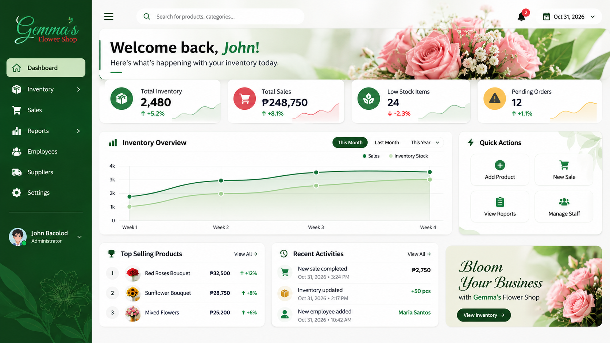

# Supplier Side UI Design Reference

**Last updated:** 2026-11-03

**Status:** Confirmed visual reference for the Supplier/Admin (Supplier Side) UI.

## 1. Purpose and scope

The project owner approved the uploaded flower-shop dashboard screenshot and supplied design prompt as the visual reference for the **Supplier Side** of FlowerTrack IMS. Use it to guide the visual direction and overall quality of the Supplier/Admin management interface.

This reference applies to the Supplier/Admin interface only. It does not automatically change the Client Panel's separate ecommerce-style direction, module order, application architecture, or any business rules.

## 2. Uploaded visual reference

The screenshot is stored in the repository at `assets/ui-references/supplier-dashboard-reference.jpg`.

### Visual characteristics to study

- Deep green/dark botanical navigation sidebar.
- Light, clean content surfaces and restrained green accents.
- Floral imagery and subtle botanical styling.
- Clear dashboard hierarchy with summary metrics, charts, quick actions, product highlights, and recent activity.
- A polished flower-business atmosphere that remains readable and practical for daily management.

These are visual cues, not a requirement to reproduce the screenshot pixel-for-pixel.

## 3. Brand and asset handling

- Treat the screenshot as a **design reference**, not as the official FlowerTrack IMS logo or final brand asset.
- Do not copy the name, logo, business identity, or proprietary content of "Gemma's Flower Shop" into FlowerTrack IMS.
- If the project owner supplies the official FlowerTrack logo separately, use that actual logo as the primary brand reference. Analyze its colors and personality and build the Supplier Side palette around it.
- Do not redraw, distort, recolor, replace, or otherwise alter an approved official logo.
- Until the official FlowerTrack logo is supplied, use the screenshot's visual direction as inspiration only; do not claim its colors are the finalized brand palette.

## 4. Owner-supplied design prompt — requirements to follow

When designing or generating Supplier Side UI screens, follow the intent of the owner's supplied prompt:

> Act as a senior UI/UX designer. Analyze the supplied brand logo for its colors, personality, and visual identity, then create a cohesive color palette and a distinctive, original interface. Prioritize professional usability, clear visual hierarchy, consistency, and a high-quality production-ready appearance. Keep the design creative and polished while maintaining a coherent brand identity. Treat the uploaded logo as the primary brand reference and do not redesign, distort, or change the logo.
>
> When the task specifically asks for a UI image, produce exactly one complete, high-fidelity UI image. Do not provide multiple variants or additional explanations with that image.

The logo-specific instructions apply when an actual FlowerTrack IMS logo is provided. The dashboard screenshot itself must not be mistaken for that logo.

## 5. Supplier Side design principles

1. **Professional and usable:** The interface must support real management work, not just look decorative.
2. **Distinctive floral identity:** Use a refined botanical/floral visual language inspired by the reference while keeping the result original to FlowerTrack IMS.
3. **Cohesive palette:** Use consistent brand, accent, neutral, background, and status colors. Confirm final brand tokens against the official FlowerTrack logo when available.
4. **Clear hierarchy:** Make page titles, key metrics, primary actions, filters, tables, and supporting information easy to scan.
5. **Consistent components:** Reuse navigation, cards, buttons, forms, tables, badges, charts, spacing, typography, borders, and states.
6. **Responsive and practical:** Preserve desktop-first management usability while supporting smaller screens.
7. **Module-aware layouts:** Adapt each screen to its actual purpose; do not force every module into a dashboard layout.
8. **Original implementation:** Use the screenshot as inspiration, not as a pixel-for-pixel template. Do not copy its business name, logo, or sample data.
9. **Preserve project constraints:** Continue using Bootstrap as the primary UI framework, Flexbox where useful, and custom CSS for brand styling. Do not add a competing UI framework without discussion.
10. **No business-rule invention:** Visual design must not silently establish inventory, order, payment, delivery, or other operational rules that remain undecided.

## 6. Application order

- Apply the design direction to the Supplier/Admin shared shell and its screens, following the module order in `MODULES.md`.
- Start with the Supplier Side Dashboard as the first screen in that module sequence.
- Keep the Client Panel visually distinct and ecommerce-oriented.
- Review each screen with the project owner before treating it as approved.
- Keep the UI-first rule: finish and review the UI before backend and database implementation.

## 7. Related documents

- [UI/UX Guidelines](UI_UX_GUIDELINES.md)
- [Requirements](REQUIREMENTS.md)
- [System Modules](MODULES.md)
- [AI Context](AI_CONTEXT.md)

## Approved module UI reference — Flower Management (2026-11-03)

The owner approved Flower Management UI and explicitly selected it as the visual reference for the next Supplier/Admin modules. Preserve the approved dashboard and shared shell; use Flower Management for module-page cards, toolbars, tables and dialogs.

- Put the module heading, short description and primary action inside the card header.
- Use a compact toolbar with Show Entries on the left and a compact search field on the right, separated by space; stack controls on narrow screens.
- Keep the approved colors, typography, button/icon treatment, card borders/radii, spacing, row density, status badges, modal forms and footer/pagination styling consistent.
- Use DataTables native sortable column headers. Actions is unsortable; do not add a separate Sort dropdown.
- Keep header labels aligned with their body values. The accepted Flower table uses left-aligned Flower Details/Category and centered Minimum Stock/Status/Actions.
- Keep Flower Details proportional to the other columns rather than allowing it to consume the remaining table width. The Flower-specific approved widths are 30% / 22% / 18% / 14% / 16%, with a fixed-layout table and horizontal scrolling when needed. Adapt widths to each future module's actual data.
- Flower Management has no duplicate Flower Catalog heading, record-count badge, category/status toolbar filters or separate sort dropdown in the approved UI.
- Adapt fields, columns, actions and any necessary filters to each module's approved scope. Reuse the design, not Flower Management's business data or an identical column list.
- Keep Blade, CSS and JavaScript separate. Consolidate component styles rather than appending repeated conflicting overrides.
- Review each subsequent module with the owner and follow the documentation/build/commit/push/verification cycle before proceeding.

Reference application files: `resources/views/supplier/flowers.blade.php`, `resources/css/supplier/flowers.css`, and `resources/js/supplier/flowers.js`. The owner approved the local UI; the latest application push still requires verification.
